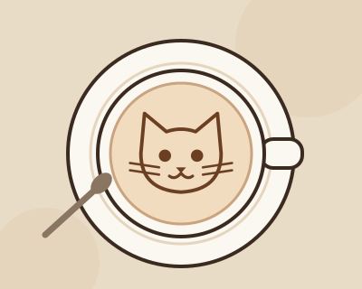

# Лабораторная работа №1

## О себе
| | |
|---|---|
| **ФИО** | Долгов Юрий Олегович |
| **Группа** | 6404-010302D |
| **Направление** | Прикладная математика и информатика |
| **Научный руководитель** | Ростова Е.П. |
| **Предполагаемая тема диплома** | Информационная система управления рисками предприятия |
| **GitHub** | [yuryich](https://github.com/yuryich) |

## Любимая цитата
> «Я знаю, что ничего не знаю»
> — Сократ

---

# Лабораторная работа №2

**Тема:** изучение основ HTML и CSS.

## 🐱 «Мурлатте» — котокафе с лазерной гравировкой на кофе

Сайт котокафе, где на молочной пене лазером выжигают котиков, панд, лисят и других милых зверьков, а по кафе гуляют настоящие котики из приюта.

| Страница | Файл | Что есть |
|---|---|---|
| Главная | [`lab2/index.html`](lab2/index.html) | Главный экран, преимущества кафе |
| Меню | [`lab2/menu.html`](lab2/menu.html) | 4 таблицы: кофе, рисунки для гравировки, десерты, тарифы на время с котиками |
| Гравировка | [`lab2/gallery.html`](lab2/gallery.html) | Как работает гравировка, галерея из 5 напитков |
| Котики | [`lab2/cats.html`](lab2/cats.html) | Карточки котиков, правила котокафе |
| О нас | [`lab2/about.html`](lab2/about.html) | История кафе, часы работы (таблица), контакты |

### Что использовано
- **HTML:** блочные (`div`, `section`, `article`, `header`, `footer`, `nav`, `figure`, `table`, `ul`, `ol`, `dl`, `blockquote`) и строчные (`a`, `span`, `strong`, `em`, `b`, `img`) элементы, ссылки, картинки, таблицы.
- **CSS:** отдельный файл [`lab2/css/style.css`](lab2/css/style.css). Селекторы: универсальный, тега, класса, ID, потомков, дочерний (`>`), соседний (`+`), атрибута (`span[data-tag]`, `.status[data-status]`), псевдоклассы (`:hover`, `:nth-child`, `:last-child`, `:first-child`), псевдоэлементы (`::before`, `::after`, `::marker`). Выравнивание в таблицах по левому краю, по центру и по правому краю. CSS-переменные, flexbox, адаптивная вёрстка через `@media`.

